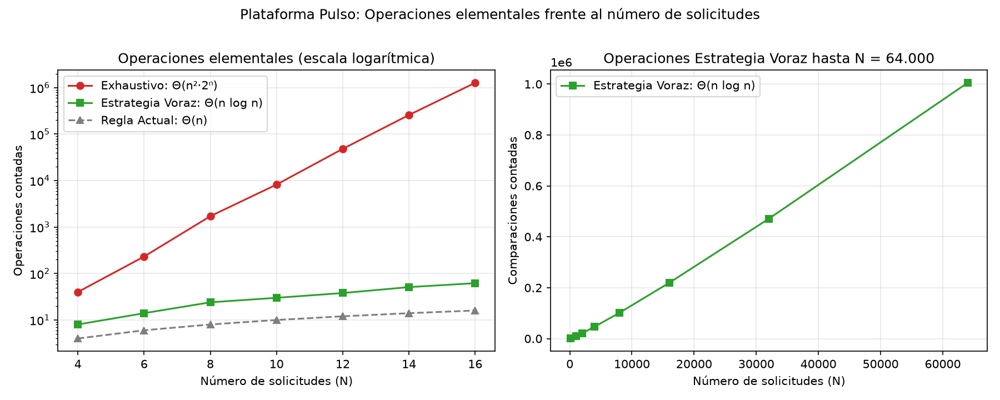
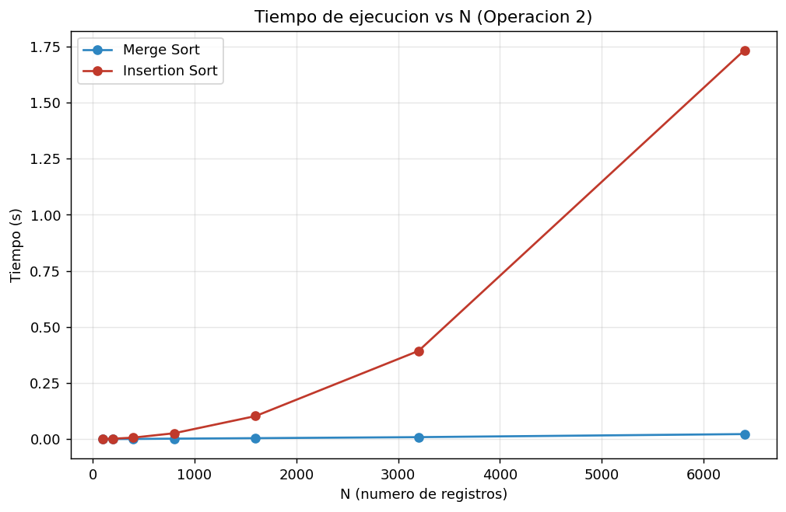
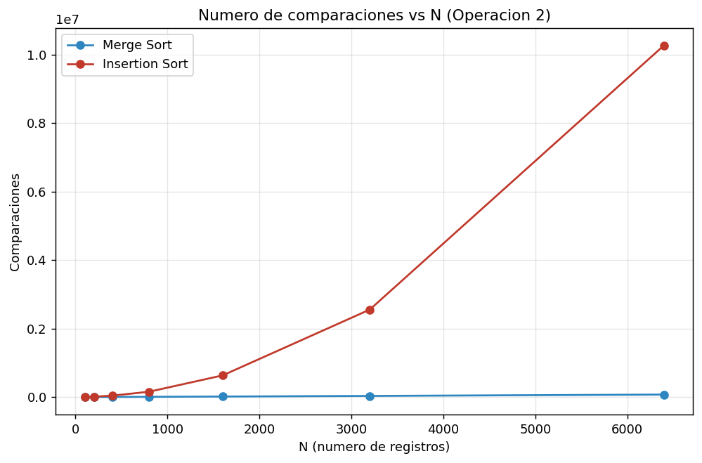

# Proyecto Final - Analisis de algoritmos 

## Plataforma Pulso

**Integrantes**
* Mariana Garcia
* Maria Fernanda Muñoz
* Diego Alejandro Quintero 
* Roberto Echeverri 

---

## Instrucciones de reproduccion para el proyecto 

para activar el entorno virtual de trabajo y ejecutar:

1. **Ubicarse en la raiz del repositorio:**
    ```bash
    cd laboratorio-final-grupal
    .\env\Scripts\Activate.ps1

2. **Instalar las dependencias**
    pip install -r requirements.txt


--------------------------------------------------------------------------------------

# Analisis del problema 

## Entradas, Salidas y Restricciones del negocio
* **Entradas**
    * Un conjuto de $N$ solicitudes de jornadas de valoracion recibidas durante el mes en una subregion especifica ($N$ varia entre 40 y 120 solicitudes por subregion al mes).
    * Cada solicitud $i$ viene representada por una tupla: ($(\text{inicio}_i, \text{fin}_i, \text{pacientes}_i)$), donde $\text{inicio}_i$ y $\text{fin}_i$ se expresa en minutos acumulados del mes ($0 \le \text{inicio}_i < \text{fin}_i \le 43.200\text{ min}$) e incluye el tiempo de desplazamiento de la unidad. $\text{pacientes}_i$ indica el numero de pacientes de alto riesgo en el municipio.

* **Salida**
    * Un subconjunto optimo de solicitudes aceptadas, ordenadas por hora de inicio, que se asignan a la unidad de movilidad sin generar solapamientos del tiempo.

* **Restriccion del negocio**
    * **Sin Traslapes**: La programacion de la unidad movil nunca  puede tener 2 jornadas que se crucen en el tiempo.
    * **Capacidad unica**: Cada subregion dispone de exactamente de una unidad movil de valoracion. 

### Supuesto tecnicos adoptados 

1. **Criterio de Solapamiento en fronteras:** Si una jornada finaliza en el minuto $M$ ($\text{fin}_1 = M$) y otra jornada inicia exactamente en el mismo minuto $M$ ($\text{inicio}_2 = M$), no se considera cruce de horario, ya que el tiempo de desplazamiento e inspeccion previa esta incluido en el calculo del limite $M$.

2. **Criterio de optimizacion elegido:** El equipo selecciona la *Estrategia voraz de seleccion de actividades* (ordenando por menor hora de fianlizacion) para maximizar la cantidad total de jornadas atendidas por la unidad movil en la subregion.


# Analisis comparativo 

## Descripcion del fallo de la regla actual 

el procedimiento actual asigna las jornadas por orden de llegada de las solicitudes y rechaza automaticamente cualquier solicitud que se cruce con una previamente aceptada. Esta regla es ineficiente porque si una solicitud que llega temprano abarca un rango de tiempo excesivamente largo, bloquea multiples jornadas mas cortas que podrian haberse atendido en ese mismo intervalo. 

## Instancia del contraejemplo calculo a mano

Considere la siguiente secuencia de 4 solicitudes que llegan a la plataforma en el orden 
$S_1, S_2, S_3, S_4$:
* Solicitud 1 ($S_1$): Inicio = 09:00 (540 min), Fin = 17:00 (1020 min), Pacientes = 40.
* Solicitud 2 ($S_2$): Inicio = 08:00 (480 min), Fin = 10:00 (600 min), Pacientes = 25.
* Solicitud 3 ($S_3$): Inicio = 10:00 (600 min), Fin = 12:00 (720 min), Pacientes = 30.
* Solicitud 4 ($S_4$): Inicio = 12:00 (720 min), Fin = 14:00 (840 min), Pacientes = 35.

1. **Procesamiento con la regal actual (Orden de llegada)**
* Evalúa $S_1$ (09:00 - 17:00): Aceptada.
* Evalúa $S_2$ (08:00 - 10:00): Se cruza con $S_1$ (09:00 - 17:00) $\rightarrow$ Rechazada.
* Evalúa $S_3$ (10:00 - 12:00): Se cruza con $S_1$ (09:00 - 17:00) $\rightarrow$ Rechazada.
* Evalúa $S_4$ (12:00 - 14:00): Se cruza con $S_1$ (09:00 - 17:00) $\rightarrow$ Rechazada.
* Resultado de la Regla Actual: Atiende 1 sola jornada ($S_1$).

2. **Procesamiento con la estrategia voraz optima**
* Ordena las solicitudes por hora de finalización: $S_2$ (Fin: 10:00), $S_3$ (Fin: 12:00), $S_4$ (Fin: 14:00), $S_1$ (Fin: 17:00).
* Selecciona $S_2$ (08:00 - 10:00) $\rightarrow$ Aceptada.
* Selecciona $S_3$ (10:00 - 12:00) $\rightarrow$ No se cruza con $S_2$ $\rightarrow$ Aceptada.
* Selecciona $S_4$ (12:00 - 14:00) $\rightarrow$ No se cruza con $S_3$ $\rightarrow$ Aceptada.
* Evalúa $S_1$ (09:00 - 17:00) $\rightarrow$ Se cruza con las anteriores $\rightarrow$ Rechazada.
*   * Resultado de la Solución Óptima: Atiende 3 jornadas ($S_2, S_3, S_4$).

**Cuantificacion del impacto**
    * **Diferencia absoluta:** La regla actual deja de atender 2 jornadas completas en la subregion.
    * **perdida relativa:** El procedimiento del coordinador desperdicia un 66.6% de la capacidad operativa de la unidad movil en esta instancia.


**Condicion contraria**
Para que la programacion dinamiaca de intervalos ponderados fuera la estrategia adecuada en lugar de la estrategia voraz de seleccion de actividades, el objetivo del negocio tendria que cambiar de maximizar la cantida de jornadas a maximizar el numero total de pacientes de alto riesgo atendidos, donde cada jornada tiene un peso diferente ($\text{pacientes}_i$) y elegir la jornada de menor duracion no garantiza acumular el mayor numero de pacientes. 

---

## Evaluación del desempeño (Operación 3: Jornadas de unidades móviles)

### 1. Complejidad teórica
- **Estrategia Voraz (Terminación más temprana):** $\Theta(n \log n)$ en tiempo (dominado por el ordenamiento por hora de finalización, seguido de una pasada lineal $\Theta(n)$) y $\Theta(n)$ en espacio auxiliar.
- **Enfoque Exhaustivo (Fuerza bruta):** $\Theta(n \cdot 2^n)$ en tiempo (evalúa los $2^n$ subconjuntos posibles y valida compatibilidad en hasta $n$ pasos) y $\Theta(n)$ en espacio.
- **Regla Actual (Orden de llegada):** $\Theta(n)$ en tiempo y $\Theta(n)$ en espacio, pero subóptima en calidad de solución.

### 2. Verificación experimental y pruebas unitarias
La corrección funcional se validó mediante [`pruebas.py`](src/jornadas_unidades/pruebas.py) y [`datos.py`](src/jornadas_unidades/datos.py) (semilla fija `2026`), cubriendo:
- Casos límite: lista vacía, una sola solicitud, solicitudes totalmente traslapadas y jornadas encadenadas en los extremos ($s_i = f_{i-1}$).
- El contraejemplo calculado a mano ($S_1, S_2, S_3, S_4$), confirmando que la regla actual acepta 1 jornada mientras la estrategia voraz obtiene las 3 óptimas sin cruces.
- 25 instancias aleatorias pequeñas donde `estrategia_voraz` iguala exactamente el número máximo de jornadas hallado por `exhaustivo` sin producir solapamientos.

### 3. Resultados experimentales y contraste empírico
Las mediciones se realizaron en [`medicion.py`](src/jornadas_unidades/medicion.py) cronometrando únicamente la ejecución algorítmica con `time.perf_counter()` (promediando 10 repeticiones para la voraz y 3 para la exhaustiva) y contando comparaciones elementales.

#### Experimento A: Comparación directa frente al enfoque exhaustivo
| $N$ (solicitudes) | Voraz (ms) | Exhaustivo (ms) | Regla Actual (ms) | Ops Voraz | Ops Exhaustivo |
| :---: | :---: | :---: | :---: | :---: | :---: |
| 4 | 0.0021 | 0.0136 | 0.0009 | 8 | 40 |
| 6 | 0.0022 | 0.0360 | 0.0007 | 14 | 232 |
| 8 | 0.0028 | 0.1745 | 0.0007 | 24 | 1,712 |
| 10 | 0.0018 | 0.5749 | 0.0009 | 30 | 8,216 |
| 12 | 0.0024 | 1.8519 | 0.0007 | 38 | 48,192 |
| 14 | 0.0027 | 7.4732 | 0.0011 | 51 | 258,432 |
| 16 | 0.0051 | 25.2141 | 0.0010 | 62 | 1,272,832 |

#### Experimento B: Escalabilidad de la estrategia voraz al duplicar $N$
| $N$ (solicitudes) | Voraz (ms) | Factor tiempo | Ops Voraz | Factor operaciones |
| :---: | :---: | :---: | :---: | :---: |
| 100 | 0.0137 | — | 635 | — |
| 1,000 | 0.1425 | — | 9,714 | — |
| 2,000 | 0.4084 | $2.87\times$ | 21,405 | $2.20\times$ |
| 4,000 | 1.1598 | $2.84\times$ | 46,879 | $2.19\times$ |
| 8,000 | 2.4323 | $2.10\times$ | 101,589 | $2.17\times$ |
| 16,000 | 6.0262 | $2.48\times$ | 219,316 | $2.16\times$ |
| 32,000 | 10.5287 | $1.75\times$ | 470,712 | $2.15\times$ |
| 64,000 | 28.7519 | $2.73\times$ | 1,004,920 | $2.13\times$ |

**Contraste teórico vs. empírico:**
- **Enfoque Exhaustivo:** Al pasar de $N = 8$ ($0.1745\text{ ms}$, $1.712\text{ ops}$) a $N = 16$ ($25.2141\text{ ms}$, $1.272.832\text{ ops}$), el tiempo se multiplicó por $144.5\times$ (cercano al factor teórico $2 \cdot 2^8 = 512\times$ de $\Theta(n \cdot 2^n)$), confirmando el crecimiento exponencial.
- **Estrategia Voraz:** Al duplicar $N$ (por ejemplo, de $8.000$ a $16.000$ y de $32.000$ a $64.000$), las operaciones elementales crecen por un factor estable de **$2.13\times$ a $2.20\times$** ("un poco más del doble"), coincidiendo exactamente con la firma matemática $\frac{2n \log_2(2n)}{n \log_2 n} = 2\left(1 + \frac{1}{\log_2 n}\right)$ de $\Theta(n \log n)$.




### 4. Extrapolación al volumen real y consumo energético (Implicaciones ambientales)
- **Volumen real del caso:** 9 subregiones, con entre $40$ y $120$ solicitudes mensuales cada una (peor caso: $N = 120$ por subregión), ejecutado en un servidor de $380\text{ W}$ ($0.38\text{ kW}$). Como referencia operativa, la programación mensual debe resolverse dentro de una ventana de planeación nocturna de $1\text{ hora}$ ($3.600\text{ s}$).
- **Estimación Estrategia Voraz:** Partiendo de la medición empírica para $N = 100$ ($0.0137\text{ ms}$) y escalando bajo $\Theta(n \log n)$ hasta $N = 120$, cada subregión toma $\approx 0.017\text{ ms}$. Para las 9 subregiones en conjunto, el tiempo total mensual es de **$0.15\text{ ms}$ ($0.00015\text{ s}$)**, cumpliendo ampliamente con la ventana operativa.
  - *Consumo energético:* $0.38\text{ kW} \times \frac{0.00015}{3600}\text{ h} \approx 1.58 \times 10^{-8}\text{ kWh/mes}$ ($1.90 \times 10^{-7}\text{ kWh/año}$).
- **Estimación Regla Actual:** Con complejidad $\Theta(n)$, para $N = 120$ en 9 subregiones tarda $\approx 0.010\text{ ms}$ totales ($1.06 \times 10^{-8}\text{ kWh/mes}$ o $1.27 \times 10^{-7}\text{ kWh/año}$). La diferencia anual de consumo eléctrico frente a la estrategia voraz es despreciable ($\approx 6.3 \times 10^{-8}\text{ kWh/año}$), pero la estrategia voraz elimina el desperdicio operativo de unidades móviles subutilizadas.
- **Estimación Enfoque Exhaustivo:** Partiendo de $N = 16$ ($25.21\text{ ms}$) y proyectando bajo $\Theta(n \cdot 2^n)$ hasta $N = 120$, el factor de crecimiento es $\frac{120}{16} \cdot 2^{104} \approx 1.52 \times 10^{32}$. Una sola subregión tardaría $\approx 1.2 \times 10^{23}\text{ años}$, por lo que **sencillamente no terminaría** y es inviable para operación real.

---

## Instrucciones de ejecución (Pruebas y Medición)
Con el entorno virtual activado y las dependencias instaladas (`pip install -r requirements.txt`):
- **Ejecutar pruebas unitarias:** `python3 src/jornadas_unidades/pruebas.py`
- **Ejecutar experimentos y regenerar gráficas:** `python3 src/jornadas_unidades/medicion.py`


## Operación 2 — Lista Diaria de Llamadas (1.450.000 Registros)

> **Enlaces al código de la Operación 2:**
> * Generador de datos sintéticos: [`src/ordenamiento_llamadas/datos.py\`](src/ordenamiento_llamadas/datos.py)
> * Algoritmo optimizado Merge Sort: [`src/ordenamiento_llamadas/estrategia.py`](src/ordenamiento_llamadas/estrategia.py)
> * Procedimiento heredado Insertion Sort: [`src/ordenamiento_llamadas/regla_actual.py`](src/ordenamiento_llamadas/regla_actual.py)

### 1. Análisis del Problema (Operación 2)

* **Entradas:** 
* Un volumen masivo diario de $N = 1.450.000$ registros pendientes de gestión almacenados en la plataforma. 
* Cada registro es una tupla: $(\text{tipo\_doc}, \text{num\_doc}, \text{id\_lab}, \text{fecha\_resultado}, \text{indice\_riesgo}, \text{municipio})$, donde $\text{indice\_riesgo} \in [6]$. 
* **Salidas:** 
* La lista de exactamente $9.000$ pacientes seleccionados para ser contactados por el call center durante la jornada. 
* **Restricción del Negocio:** 
* **Prioridad Estricta por Riesgo:** Ningún paciente con menor riesgo puede quedar ubicado por encima de uno con mayor riesgo que haya sido excluido. 
* **Criterio de Desempate por Antigüedad:** A igual índice de riesgo, se debe priorizar el resultado con la fecha más antigua. 
* **Ventana Nocturna Estricta:** Las Operaciones 1 y 2 deben completarse conjuntamente dentro de una ventana inflexible de 4 horas (01:00 a. m. a 05:00 a. m.). 
--- 
### 2. Diseño de la Solución y Ejemplo Resuelto a Mano 

#### Por qué el problema admite Merge Sort ($\Theta(N \log N)$) 
El problema de generar la lista diaria exige un ordenamiento determinista por dos claves (riesgo descendente y fecha ascendente). *Merge Sort* es ideal porque: 
1. Aplica el paradigma de **Divide y Vencerás**, garantizando una complejidad determinista $\Theta(N \log N)$ en el mejor, promedio y peor caso. 
2. Es un algoritmo **Estable**, lo que preserva el orden relativo temporal exacto de los registros sin alterar la antigüedad del paciente. 
#### Ejemplo Resuelto a Mano (4 Registros): 
Considere los siguientes 4 registros recibidos en la plataforma: 
* $R_1$: Doc 101, Riesgo: 85, Fecha: "2026-11-10 10:00" 
* $R_2$: Doc 102, Riesgo: 95, Fecha: "2026-11-12 08:00" 
* $R_3$: Doc 103, Riesgo: 85, Fecha: "2026-11-05 14:00" 
* $R_4$: Doc 104, Riesgo: 60, Fecha: "2026-11-15 09:00" 

**Paso 1 (División):** Se divide la lista en dos mitades de 2 elementos: 
* Izquierda: $[R_1, R_2]$, Derecha: $[R_3, R_4]$. 

**Paso 2 (Conquista y Mezcla local):** 
* Mitad izquierda ordenada por riesgo: $[R_2 \text{ (95)}, R_1 \text{ (85)}]$. 
* Mitad derecha ordenada por riesgo: $[R_3 \text{ (85)}, R_4 \text{ (60)}]$. 

**Paso 3 (Mezcla Final con Desempate):** 
1. Compara $R_2$ (95) vs $R_3$ (85) $\rightarrow$ Elige $R_2$. 
2. Compara $R_1$ (85) vs $R_3$ (85) $\rightarrow$ Empate en riesgo. Evalúa fechas ("2026-11-10" vs "2026-11-05"). $R_3$ es más antiguo $\rightarrow$ Elige $R_3$. 
3. Compara $R_1$ (85) vs $R_4$ (60) $\rightarrow$ Elige $R_1$. 
4. Anexa el sobrante $R_4$. 

**Resultado Final Ordenado:** $[R\_2, R\_3, R\_1, R\_4]$.

## Operación 2 — Lista Diaria de Llamadas (1.450.000 Registros)

> **Enlaces al código de la Operación 2:**
> * Generador de datos sintéticos: [`src/ordenamiento_llamadas/datos.py`](src/ordenamiento_llamadas/datos.py)
> * Algoritmo optimizado Merge Sort: [`src/ordenamiento_llamadas/estrategia.py`](src/ordenamiento_llamadas/estrategia.py)
> * Procedimiento heredado Insertion Sort: [`src/ordenamiento_llamadas/regla_actual.py`](src/ordenamiento_llamadas/regla_actual.py)
> * Pruebas unitarias: [`src/ordenamiento_llamadas/pruebas.py`](src/ordenamiento_llamadas/pruebas.py)
> * Benchmark y mediciones: [`src/ordenamiento_llamadas/medicion.py`](src/ordenamiento_llamadas/medicion.py)

### 1. Análisis del Problema (Operación 2)

* **Entradas:**
  * Un volumen masivo diario de \(N = 1.450.000\) registros pendientes de gestión almacenados en la plataforma.
  * Cada registro es una tupla: \((\text{tipo\_doc}, \text{num\_doc}, \text{id\_lab}, \text{fecha\_resultado}, \text{indice\_riesgo}, \text{municipio})\), donde \(\text{indice\_riesgo} \in [0, 100]\).
* **Salidas:**
  * La lista de exactamente 9.000 pacientes seleccionados para ser contactados por el call center durante la jornada.
* **Restricción del Negocio:**
  * **Prioridad Estricta por Riesgo:** Ningún paciente con menor riesgo puede quedar ubicado por encima de uno con mayor riesgo que haya sido excluido.
  * **Criterio de Desempate por Antigüedad:** A igual índice de riesgo, se debe priorizar el resultado con la fecha más antigua.
  * **Ventana Nocturna Estricta:** Las Operaciones 1 y 2 deben completarse conjuntamente dentro de una ventana inflexible de 4 horas (01:00 a. m. a 05:00 a. m.).

---

### 2. Diseño de la Solución y Ejemplo Resuelto a Mano

#### Por qué el problema admite Merge Sort (\(\Theta(N \log N)\))

El problema de generar la lista diaria exige un ordenamiento determinista por dos claves (riesgo descendente y fecha ascendente). *Merge Sort* es ideal porque:
1. Aplica el paradigma de **Divide y Vencerás**, garantizando una complejidad determinista \(\Theta(N \log N)\) en el mejor, promedio y peor caso.
2. Es un algoritmo **Estable**, lo que preserva el orden relativo temporal exacto de los registros sin alterar la antigüedad del paciente.

#### Ejemplo Resuelto a Mano (4 Registros):

Considere los siguientes 4 registros recibidos en la plataforma:
* \(R_1\): Doc 101, Riesgo: 85, Fecha: "2026-11-10 10:00"
* \(R_2\): Doc 102, Riesgo: 95, Fecha: "2026-11-12 08:00"
* \(R_3\): Doc 103, Riesgo: 85, Fecha: "2026-11-05 14:00"
* \(R_4\): Doc 104, Riesgo: 60, Fecha: "2026-11-15 09:00"

**Paso 1 (División):** Se divide la lista en dos mitades de 2 elementos: Izquierda: \([R_1, R_2]\), Derecha: \([R_3, R_4]\).

**Paso 2 (Conquista y Mezcla local):**
* Mitad izquierda ordenada por riesgo: \([R_2 (95), R_1 (85)]\).
* Mitad derecha ordenada por riesgo: \([R_3 (85), R_4 (60)]\).

**Paso 3 (Mezcla Final con Desempate):**
1. Compara \(R_2 (95)\) vs \(R_3 (85)\) \(\rightarrow\) Elige \(R_2\).
2. Compara \(R_1 (85)\) vs \(R_3 (85)\) \(\rightarrow\) Empate en riesgo. Evalúa fechas ("2026-11-10" vs "2026-11-05"). \(R_3\) es más antiguo \(\rightarrow\) Elige \(R_3\).
3. Compara \(R_1 (85)\) vs \(R_4 (60)\) \(\rightarrow\) Elige \(R_1\).
4. Anexa el sobrante \(R_4\).

**Resultado Final Ordenado:** \([R_2, R_3, R_1, R_4]\).

---

### 3. Evaluación del Desempeño (Operación 2 — Integrante 2)

#### 3.1 Complejidad teórica

| Algoritmo | Mejor caso | Caso promedio | Peor caso | Espacio extra |
|-----------|------------|---------------|-----------|---------------|
| Merge Sort (`estrategia.py`) | \(\Theta(N \log N)\) | \(\Theta(N \log N)\) | \(\Theta(N \log N)\) | \(\Theta(N)\) |
| Insertion Sort (`regla_actual.py`) | \(\Theta(N)\) | \(\Theta(N^2)\) | \(\Theta(N^2)\) | \(\Theta(1)\) |

El Merge Sort siempre se comporta igual (no tiene caso malo), mientras que el Insertion Sort se dispara cuando los datos vienen desordenados, que es justo lo que pasa con los 1.450.000 registros reales.

#### 3.2 Verificación experimental y pruebas unitarias

La corrección funcional se validó mediante [`pruebas.py`](src/ordenamiento_llamadas/pruebas.py), cubriendo:
* **Casos límite:** lista vacía, un solo elemento, dos elementos ya ordenados.
* **Regla del negocio:** que el riesgo quede de mayor a menor y que a igual riesgo gane la fecha más vieja.
* **Empates totales:** si empatan en riesgo y fecha, se verifica que se conserven todos los registros (el orden entre idénticos no importa).
* **El ejemplo del README (R1..R4):** que ambos algoritmos den lo mismo que hicimos a mano.
* **Validación cruzada:** que los dos algoritmos coincidan con varias semillas (1, 7, 42 y 2026).
* **Conservación:** que no se pierdan ni dupliquen registros.

**Salida en consola:**
```text
Corriendo 11 pruebas...
  [OK] prueba_lista_vacia
  [OK] prueba_un_elemento
  [OK] prueba_dos_elementos_ordenados
  [OK] prueba_desempate_antiguedad
  [OK] prueba_riesgo_predomina_sobre_fecha
  [OK] prueba_empate_total_no_importa_orden
  [OK] prueba_ejemplo_manual_readme
  [OK] prueba_coincidencia_con_datos_sinteticos
  [OK] prueba_invariante_riesgo_no_creciente
  [OK] prueba_misma_cantidad_de_registros
  [OK] prueba_es_mayor_o_igual
Listo, las 11 pruebas pasaron bien.

#### 3.3 Resultados experimentales y contraste empírico

Las mediciones se realizaron en [`medicion.py`](src/ordenamiento_llamadas/medicion.py) cronometrando únicamente la ejecución algorítmica con `time.perf_counter()`, con semilla fija (42). Los tiempos son aproximados y dependen del equipo donde se corran, pero el número de comparaciones es determinista.

*Experimento A: Medición directa de tiempos y operaciones*

| \(N\) | Merge Sort (s) | Merge (cmp) | Insertion Sort (s) | Insertion (cmp) |
| :---: | :---: | :---: | :---: | :---: |
| 100 | 0.00031 | 538 | 0.00044 | 2,769 |
| 200 | 0.00043 | 1,277 | 0.00188 | 11,042 |
| 400 | 0.00087 | 2,940 | 0.00677 | 41,388 |
| 800 | 0.00212 | 6,685 | 0.02625 | 155,822 |
| 1,600 | 0.00429 | 15,016 | 0.10290 | 632,359 |
| 3,200 | 0.00887 | 33,210 | 0.39316 | 2,553,655 |
| 6,400 | 0.02249 | 72,920 | 1.73321 | 10,267,844 |

**Contraste teórico vs. empírico:**
* **Merge Sort:** Al pasar de \(N=3.200\) a \(N=6.400\) el tiempo creció más o menos **\(2.5\times\)** y las comparaciones **\(2.2\times\)**. La teoría dice que con \(N \log N\) el factor debería ser cercano a 2.1, así que coincide (la diferencia en tiempo es por el ruido del procesador).
* **Insertion Sort:** Al doble de \(N\) el tiempo creció casi **\(4.4\times\)** y las comparaciones casi **\(4\times\)**. Eso es exactamente lo que uno espera con \(N^2\).
* A medida que \(N\) crece la diferencia entre los dos se hace enorme: con \(N=100\) el Merge es solo 1.4 veces más rápido, pero con \(N=6.400\) ya es como **77 veces más rápido**. Por eso el Insertion no sirve para el volumen real.

**Gráficas generadas:**





#### 3.4 Extrapolación al volumen real y consumo energético

Para estimar el consumo anual supusimos:
* Un computador del call center gasta unos **200 W** (0.2 kW).
* La operación se corre **una vez al día**, 365 días al año.
* Extrapolamos con el modelo de complejidad de cada uno (\(N \log N\) para Merge, \(N^2\) para Insertion).

| Estrategia | Tiempo con \(N=1.450.000\) | Consumo estimado al año |
| :--- | :---: | :---: |
| Merge Sort (propuesto) | ~8.2 s (0.14 min) | ~0.17 kWh/año |
| Insertion Sort (actual) | ~88,967 s (24.7 h) | ~1,804 kWh/año |

El ahorro es de aproximadamente **1.804 kWh al año** (más del 99.99% menos consumo). Con Merge Sort el proceso deja de ser un problema energético y además **cabe de sobra** en la ventana nocturna de 4 horas.
